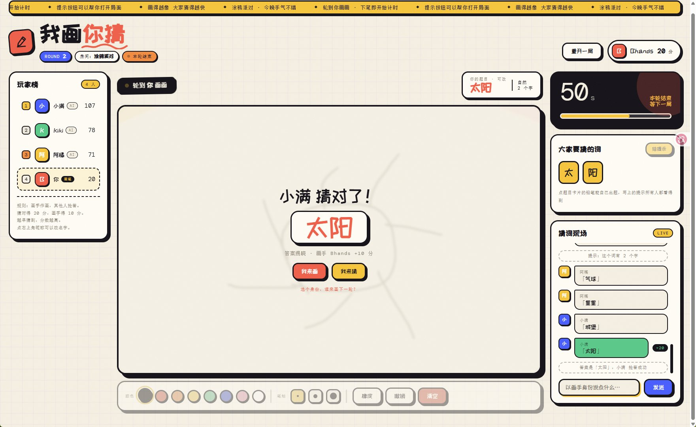

<div align="center">

# 🎨 我画你猜 · 涂鸦派对

**一个实时联机「你画我猜」网页小游戏**
—— 一个画手位 + 不限人数猜图者，笔画实时同步，服务端统一判题、计时、计分。

     

**在线体验**：[点我开始画](https://draw-guess-party-47688.app.workbuddy.host/?sharecode=H2CRELLE3J)

</div>

---

## ✨ 这是什么

<div align="center">



<p align="center">🎨 纸感涂鸦风格 · 实时联机 · 猜中撒花 —— 左上玩家榜、中央共享画布、右侧猜词现场</p>

</div>

一个打开网页就能玩的「你画我猜」：无需注册，填个昵称选「我来画」或「我来猜」就能进场。画手画、大家猜，笔画毫秒级同步，服务端统一判题计分。前端原生 JS + Canvas 2D，后端 Node.js + Socket.IO，没有框架、没有构建步骤。

| 模块 | 能力 |
|------|------|
| 🖌️ **实时画布** | 笔画分三段广播（start / points / end），本地先画不等回包，所有人同步看到；8 色画笔 + 橡皮 + 撤销 + 清空 |
| 👥 **身份与房间** | 首次进场填昵称 + 选身份；**单画手位**，被占则自动降级猜图者；猜图者人数不限；每轮结束双方重选身份 |
| 🔒 **题目保密** | 题目只有画手可见（猜图者只看到字数遮罩）；分类和提示语双方公开；开发者工具也偷不到答案 |
| ✏️ **画手自定义** | 题目卡片铅笔按钮改**题目**（1–8 字）和**提示**（≤30 字）；计时卡片时钟按钮改**时长**（15–300 秒，预设 30/60/80/120/180） |
| 🙋 **请求机制** | 猜图者只能「请求提示 / 我来猜 / 请求重开」，请求进聊天栏 + 画手画布顶部弹大字通知（缩小消失动画）；画手决定何时响应 |
| 🤖 **AI 陪玩** | 只有 1 个真人时自动补 3 个 AI（小满 / 阿橘 / Kiki），按节奏说错答案并猜中；第二个真人进来 AI 自动退场 |
| 📊 **玩家榜与动态** | 在线玩家实时榜（离线的不占榜位）、猜词现场（楼中楼式）、顶部滚动条显示**真实进出人名**、点赞式猜中与撒花 |
| 🛡️ **稳定性** | 画手掉线即时结算并保留续画窗口、请求幂等去重、断线清请求、离线 3 分钟出榜、客户端脚本双源降级加载 |

---

## 🚀 快速开始

### 本地体验（无需构建）

```bash
cd socket.io
npm install
node index.js          # 打开 http://localhost（默认 80 端口）
```

> 需要 Node.js 18+。端口被占用可用环境变量覆盖：`PORT=3000 node index.js`。


---

## 🎮 玩法与权限

1. **首次进入**：填昵称，选「我来画」或「我来猜」。画手位已被占用时「我来画」变灰并显示当前画手名，后来者只能猜。
2. **出题**：画手随机拿题，或点铅笔自己定题目和提示。题目只自己看得见，分类和提示大家看得见。
3. **计时**：画手第一次下笔才开始倒计时，默认 80 秒，可改成 15–300 秒。
4. **判题**：猜对者 +20 分，画手 +10 分，第一个猜中的结束本轮。
5. **提示**：猜图者请求 → 画手画布弹通知 → 画手点「给提示」逐字揭示。
6. **下一轮**：本轮结束横幅上双方重选身份，「我来画」立即开新一轮，「我来猜」只登记意愿。昵称只在首次设置。
7. **重开一局**：猜图者只能请求；画手点「重开一局」后分数清零、退出画手位，回到选身份界面。

### 权限模型

| 操作 | 画手 | 猜图者 |
|------|------|--------|
| 改题目 / 改提示 | ✅ | ❌ |
| 设本轮时长 | ✅ | ❌ |
| 给提示（逐字揭示） | ✅ | 只能请求提示 |
| 开始下一轮 | ✅（点「我来画」抢位） | 只能「我来猜」登记意愿 |
| 重开一局 | ✅ | 只能请求重开 |
| 重画同一题 | ✅ | ❌ |

猜图者的每次请求都会写入聊天栏，并在画手画布顶部弹一条大字号通知（从大到小缩放消失，约 3 秒）。请求按人幂等去重，不会刷屏。

### 边界情况

- **画手掉线** → 本轮立即结算、画手位空出，任何猜图者点「我来画」即可接手；**只是刷新** → 题目和画布都还在，重新选画手就接着画。
- **请求者掉线** → 其提示/重开/下一轮请求记录自动清除，画手按钮上的红点不残留。
- **只有你一个人** → 自动补 3 个 AI 陪玩，单人也能跑通完整回合；第二个真人进来 AI 自动退出。
- **词库** → 内置 49 词 / 11 分类（水果、运动、自然、物品、科技、美食、交通、动物、建筑、乐器、饮品），以 2 字词为主。

---

## 🖼️ 界面一览

单页应用，按状态呈现不同界面：

| 区域 | 说明 |
|------|------|
| 🏠 入场卡片 | 首次进场填昵称 + 选「我来画 / 我来猜」，画手位被占时灰掉并提示 |
| 📜 顶部滚动条 | 真实玩家进出记录 + 装饰文案，内容不足时自动重复铺满、无缝滚动 |
| 🎨 画布区 | 纸感底纹 + 粗黑描边，实时同步笔迹；请求通知从顶部大字缩小消失 |
| 🧰 工具栏 | 8 色调色盘 + 橡皮 / 撤销 / 清空，仅画手可操作 |
| ⏱️ 计时卡片 | 剩余时间 + 出题者信息，画手可展开设置区改时长 |
| 🏷️ 题目卡片 | 画手见完整题目，猜图者见字数遮罩；分类与提示双方可见；铅笔编辑 |
| 💬 猜词现场 | 猜词记录 + 匿名评论式展示，猜中高亮撒花 |
| 🏆 玩家榜 | 在线玩家实时排名与分数 |
| 🎉 结算横幅 | 揭示答案、双方重选下一轮身份、重开一局入口 |

---


### 房间状态机

| phase | 含义 |
|-------|------|
| `waiting` | 还没有画手，等有人接画笔 |
| `idle` | 画手就位、题目已出，等第一笔 |
| `drawing` | 计时中 |
| `revealed` | 本轮结束，展示答案 / 重选身份 |

`reset` 后同样进入 `revealed`，但题目被清空，前端据此显示「新的一局 · 分数已清零 · 选个身份开始」。

### 关键设计

- **零依赖数据层**：房间状态全在 `state` 内存对象里，无数据库、无文件读写，备份和恢复都无需关心数据文件。
- **按连接定制视图**：`state` 事件 per-socket 下发——画手拿完整 `word`，其他人只拿 `mask`；分类 `cat` 和提示 `hintText` 对所有人公开。
- **笔画不等回包**：本地 `pointermove` 立即绘制，按 32ms 节流批量发 `stroke:points`，观感不受网络往返影响；服务端最多保留 240 笔防内存膨胀。
- **身份用 localStorage key**：`socket.id` 只负责路由，客户端 key 决定积分归属，刷新 / 断线重连都不掉分；昵称只在首次入场设置。
- **画手掉线保留位置**：只结算本轮不清空 `drawerKey`，给刷新留续画窗口；别人接手时才真正释放。
- **请求集合按人去重**：`hintAsks` / `nextVotes` / `resetAsks` 三个 Set，幂等登记、断线即清、开局 / 结算时清空；通知只定向推给当前画手。
- **在线玩家过滤**：`viewFor` 下发时滤掉离线玩家，但服务端保留其分数以便重连恢复；`sweepOffline` 每分钟清理超 3 分钟的离线者。
- **脚本双源降级**：`/socket.io/socket.io.js` 拉不到时回退到项目内 `js/socket.io.min.js`，两源都失败整轮重试；sharecode 同时拼进脚本 `src` 和握手 `query`。
- **滚动条自适应**：按容器宽度动态重复内容保证铺满可视区，按宽度换算滚动时长保持速度恒定，不会滚到右侧露白。

---

## 📂 目录结构

```
socket.io/
├── index.js                  # HTTP 静态服务 + Socket.IO 房间状态机 + 49 词词库
├── index.html                # 前端单页（视觉稿 + 联机逻辑 + 入场/轮间选身份）
├── package.json              # npm start 入口（依赖 socket.io）
├── package-lock.json
├── js/
│   └── socket.io.min.js      # 客户端副本，主路径失效时的降级来源
├── docs/
│   └── preview.jpg           # README 顶部展示的游戏界面截图
├── .gitignore / .gitattributes
└── README.md                 # 本文件
```

运行时只需要 `index.js` + `index.html` + `js/socket.io.min.js` + `package.json`。

外层 `F:/UE/yourguess/` 还保留 `.upstream-socketio-git/`（上游仓库历史备份）与 `.workbuddy/`（项目数据），与本游戏运行无关。

---

## 📡 事件协议

统一走 Socket.IO 长连接，`state` 为每人定制视图：

| 事件 | 方向 | 说明 |
|------|------|------|
| `join` | C→S | 带 `{key, name, role}` 入场；画手位被占时 `role=drawer` 降级猜图者并回 toast |
| `take:drawer` | C→S | 画手位空着时接手画笔 |
| `rename` | C→S | 改昵称 |
| `stroke:start` / `stroke:points` / `stroke:end` | C→S→C | 笔画分三段广播，只接受当前画手的笔迹 |
| `undo` / `clear` | C→S→C | 撤销 / 清空画布，全量 `canvas:init` 重绘 |
| `topic:set` | C→S | 画手改题目（1–8 字）/ 提示（≤30 字），改完清画布并重置计时 |
| `time:set` | C→S | 画手设时长，夹取 15–300 秒；计时中改按新值重启 |
| `hint:request` | C→S | 猜图者请求提示 → `feed:sys` + 画手定向 `notice` |
| `hint` | C→S→C | 画手逐字揭示；非画手调用被拒 |
| `next:request` / `next` | C→S | 猜图者「我来猜」登记意愿 / 任何人「我来画」抢位并立即开局 |
| `reset:request` / `reset` | C→S | 猜图者请求重开 / 画手执行重开（清分回到选身份界面） |
| `guess` | C→S | 服务端判题后广播到猜词现场 |
| `state` | S→C | 每人一份定制视图（题目 / 提示 / 请求状态按身份下发） |
| `tick` / `round:end` | S→C | 倒计时与结算 |
| `feed` / `feed:sys` | S→C | 猜词记录与系统消息（含所有请求） |
| `presence` | S→C | 真实玩家进出房，驱动顶部滚动条 |
| `notice` | S→画手 | 只发给当前画手的画布通知 |

---

## 📖 已知限制

- **房间状态存在内存里**，重启进程即清空分数和画布；部署更新也会重置房间。
- **单房间设计**，不支持多房间 / 房间号。
- **没有账号体系**，身份靠浏览器 localStorage，换设备就是新玩家。
- **提示只揭示字**，不扣分。

---

